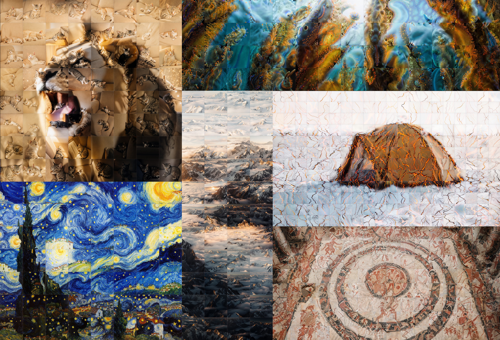

<p align="center">
  
</p>

<p align="center">
  <a href="https://kooroshrh.github.io/photo-quilt/"></a>
  <a href="https://arxiv.org/abs/2606.30968"></a>
  <a href="https://huggingface.co/papers/2606.30968"></a>
  <a href="https://www.dropbox.com/scl/fi/jw8a5wtaoiuvkf0u9hvtq/PhotoQuilt.pdf?rlkey=qgecfwn4mp16hcmgj2pxrcrb6&dl=1"></a>
</p>

---

**PhotoQuilt** is a training-free framework for generating photomosaics at arbitrary resolution. A low-resolution bootstrap pass fixes the global layout; the latent canvas is upscaled and re-noised; denoising then proceeds in fixed tiles so each region becomes its own convincing image while the overall scene stays coherent.

<p align="center">
  
</p>

## Installation

```bash
git clone https://github.com/KooroshRH/PhotoQuilt.git
cd PhotoQuilt

# Install PyTorch for your CUDA version first, then:
pip install -r requirements.txt
```

Model weights are downloaded from Hugging Face on first run.

## Repository layout

```text
PhotoQuilt/
├── flux1/     # FLUX.1-Krea-dev
├── flux2/     # FLUX.2-klein-9B (distilled)
├── sd21/      # Stable Diffusion 2.1
└── outputs/   # default output directory (created per run)
```

Run each backend from inside its folder:

```bash
cd flux1 && python run_flux1.py ...
cd flux2 && python run_flux2.py ...
cd sd21  && python run_sd21_mosaic.py ...
```

## Method (four phases)

All backends follow the same high-level procedure:

1. **Bootstrap** — generate at `--bootstrap-size` or load `--base-image`.
2. **Latent upscale** — bicubic upscale to `--height` × `--width`.
3. **Noise injection** — inject noise at step `steps − noise-steps`.
4. **Tiled denoise** — complete the tail in fixed `--tile-size` windows.

In the paper, renoising **strength** \(s\) is **`noise-steps / steps`** (e.g. `--steps 28 --noise-steps 17` → \(s \approx 0.61\), the FLUX.1 default in the paper).

## Checkpoints

We evaluate PhotoQuilt with these Hugging Face checkpoints (used in the paper):

| Backend | Checkpoint |
|---------|------------|
| FLUX.1 | [`black-forest-labs/FLUX.1-Krea-dev`](https://huggingface.co/black-forest-labs/FLUX.1-Krea-dev) |
| FLUX.2 | [`black-forest-labs/FLUX.2-klein-9B`](https://huggingface.co/black-forest-labs/FLUX.2-klein-9B) (distilled) |
| SD 2.1 | [`Manojb/stable-diffusion-2-1-base`](https://huggingface.co/Manojb/stable-diffusion-2-1-base) |

Gallery mode on FLUX.1 additionally uses [`black-forest-labs/FLUX.1-Redux-dev`](https://huggingface.co/black-forest-labs/FLUX.1-Redux-dev).

## FLUX.1 (`flux1/`)

Checkpoint: **`black-forest-labs/FLUX.1-Krea-dev`** (default `--checkpoint Krea-dev`).

**Quick start**

```bash
cd flux1
python run_flux1.py \
  --height 4096 --width 4096 \
  --steps 28 --noise-steps 17 \
  --tile-size 1024 \
  --prompt "a serene mountain lake at sunrise" \
  --tile-prompt "a bird"
```

**Bootstrap from an image**

```bash
cd flux1
python run_flux1.py \
  --base-image path/to/reference.jpg \
  --height 8192 --width 8192 \
  --steps 28 --noise-steps 17 \
  --tile-size 512 \
  --tile-prompt "a bird"
```

**Gallery mosaic (per-tile reference images via FLUX.1 Redux)**

```bash
cd flux1
python run_flux1.py \
  --base-image path/to/group_photo.png \
  --tile-image-dir path/to/gallery/ \
  --tile-prompt "a vivid photo collage tile" \
  --height 8192 --width 8192 \
  --steps 28 --noise-steps 17 \
  --tile-size 1024 \
  --seed 42
```

**Multi-GPU (tile-parallel denoising + decode)**

```bash
cd flux1
CUDA_VISIBLE_DEVICES=0,1 python run_flux1.py \
  --height 8192 --width 8192 \
  --steps 28 --noise-steps 17 \
  --tile-size 256 \
  --multi-gpu \
  --base-image path/to/reference.jpg \
  --tile-prompt "a bird"
```

Requires a tile-aligned canvas (`height` and `width` are exact multiples of `--tile-size`) and at least as many tile-rows as visible GPUs.

---

## FLUX.2 Klein (`flux2/`)

Checkpoint: **`black-forest-labs/FLUX.2-klein-9B`** (distilled; pass `--checkpoint klein`). Default schedule: `--steps 8 --noise-steps 5` (\(s = 5/8\)). Per-tile reference images use FLUX.2-native in-context conditioning (no Redux).

**Quick start**

```bash
cd flux2
python run_flux2.py \
  --checkpoint klein \
  --height 4096 --width 4096 \
  --steps 8 --noise-steps 5 \
  --tile-size 1024 \
  --prompt "a serene mountain lake at sunrise" \
  --tile-prompt "a bird"
```

**Gallery mosaic**

```bash
cd flux2
python run_flux2.py \
  --checkpoint klein \
  --base-image path/to/layout.png \
  --tile-image-dir path/to/gallery/ \
  --tile-prompt "a vivid photo collage tile" \
  --height 6144 --width 6144 \
  --steps 8 --noise-steps 5 \
  --tile-size 1024
```

---

## Stable Diffusion 2.1 (`sd21/`)

Checkpoint: **`Manojb/stable-diffusion-2-1-base`** (default `--model`).

```bash
cd sd21
python run_sd21_mosaic.py \
  --height 2048 --width 2048 \
  --steps 50 --noise-steps 35 \
  --tile-size 512 \
  --prompt "a city skyline at dusk" \
  --tile-prompt "a bird"
```

---

## Flags

Core options (all backends):

| Flag | Description |
|------|-------------|
| `--height` / `--width` | Output resolution (pixels). |
| `--bootstrap-size` | Bootstrap long side (`1024` FLUX, `768` SD 2.1). |
| `--tile-size` | Tile / attention window side. |
| `--steps` / `--noise-steps` | Denoising schedule; paper strength \(s =\) `noise-steps / steps`. |
| `--prompt` / `--tile-prompt` | Global layout prompt and per-tile prompt. |
| `--base-image` | Bootstrap from an image instead of generating. |
| `--seed` | Random seed. |

Model-specific:

- **FLUX.1 / FLUX.2:** `--tile-image-dir` for gallery mosaics (FLUX.1 uses Redux; FLUX.2 uses native reference conditioning).
- **FLUX.1:** `--multi-gpu` for tile-parallel generation on multiple GPUs.
- **FLUX.2:** `--checkpoint klein` for the distilled model.
- **SD 2.1:** `--model` to pick the Hugging Face checkpoint.

Run `python run_<backend>.py --help` for all options (including advanced tuning flags).

## Outputs

Images are saved under `--output-dir` (default `outputs/`). FLUX backends use descriptive timestamped filenames; SD 2.1 writes to a run subfolder with `mosaic.png`.

## Requirements

- Python 3.10+
- CUDA GPU recommended (CPU offload is enabled automatically on FLUX backends when VRAM is below ~60 GB)
- See `requirements.txt` for package versions

## Acknowledgments

This implementation adapts the inference layout and scripting conventions from [SEGA](https://github.com/rajabi2001/sega) (Rajabi et al., 2026). PhotoQuilt builds on diffusers, Hugging Face model hubs, and the FLUX / Stable Diffusion ecosystems.

## Citation

If you find PhotoQuilt useful, please cite:

```bibtex
@misc{roohi2026photoquilt,
  title={PhotoQuilt: Training-Free Arbitrary-Resolution Photomosaics via Bootstrapped Tiled Denoising},
  author={Koorosh Roohi and Javad Rajabi and Andrew Fleet and Babak Taati},
  year={2026},
  eprint={2606.30968},
  archivePrefix={arXiv},
  primaryClass={cs.CV},
  url={https://arxiv.org/abs/2606.30968},
}
```
